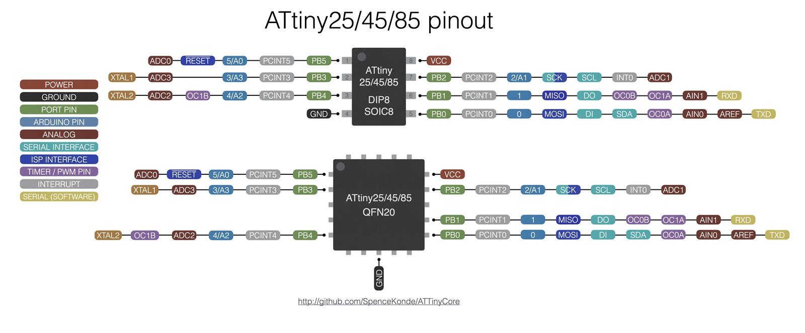

# ATtiny85 (DIP-8)

[← Board-Übersicht](../README.md)

> [!WARNING]
> **Advanced.** Der ATtiny85 ist nichts für den Einstieg. Er hat keinen USB-Anschluss und wird über ein **zweites Board als Programmer** beschrieben. Ihr braucht also zwei Mikrocontroller, mehr Verkabelung und etwas Geduld bei der Fehlersuche. Wer zum ersten Mal mit Mikrocontrollern arbeitet: Nehmt einen [XIAO ESP32-S3](../XIAO-ESP32-S3/README.md).

Kein Board, sondern ein **einzelner Mikrocontroller-Chip** mit 8 Beinchen. 8 KB Programmspeicher, 512 Byte RAM, **5 nutzbare I/O-Pins**, kein USB, kein WLAN. Läuft (als „V“-Variante) von 1,8 bis 5,5 V und braucht sehr wenig Strom. Gut für kleine, feste Aufgaben (z. B. LED-Effekte, Taster auswerten, einfacher Sensor), die nicht gleich einen ESP32 brauchen.

**Doku:** [Microchip ATtiny85 Produktseite + Datenblatt](https://www.microchip.com/en-us/product/attiny85) · [ArduinoISP (Arduino-Doku)](https://docs.arduino.cc/built-in-examples/arduino-isp/ArduinoISP/)
**PlatformIO:** [platformio.ini](platformio.ini) für den ATtiny und das fertige Projekt [ArduinoISP-Programmer](ArduinoISP-Programmer/) für das Programmer-Board

## Pinout



<sub>Quelle: Spence Konde, [ATTinyCore](https://github.com/SpenceKonde/ATTinyCore). Relevant ist die obere Grafik (DIP8).</sub>

## Pins auf einen Blick

| Beinchen | Port | Arduino-Pin | Funktionen |
|---|---|---|---|
| 1 | PB5 | 5 / A0 | **RESET**. Nicht als normalen Pin verwenden |
| 2 | PB3 | 3 / A3 | analog |
| 3 | PB4 | 4 / A2 | analog, PWM |
| 4 | GND | | Masse |
| 5 | PB0 | 0 | PWM, **SDA** (I2C), MOSI |
| 6 | PB1 | 1 | PWM, MISO |
| 7 | PB2 | 2 / A1 | analog, **SCL** (I2C), SCK |
| 8 | VCC | | Versorgung 1,8–5,5 V |

**Beinchen 1** ist dort, wo die **Kerbe bzw. der Punkt** auf dem Chip ist. Von dort gegen den Uhrzeigersinn weiterzählen.

## So programmiert man ihn: ein Board als Programmer

Das Prinzip: Ein **XIAO ESP32-S3** bekommt den Sketch *ArduinoISP* und wird damit zum **Programmer**. Er nimmt das Programm vom Laptop über USB entgegen und schreibt es über die **ISP-Leitungen** (SPI + RESET) in den ATtiny.

```
Laptop ──USB──► XIAO ESP32-S3 (Programmer) ──ISP: MOSI/MISO/SCK/RESET──► ATtiny85 (Ziel)
```

### 1. Verdrahten

ATtiny in den IC-Sockel bzw. über den Mittelgraben des Steckbretts setzen, dann:

| XIAO ESP32-S3 | ATtiny85 |
|---|---|
| D10 (MOSI) | Beinchen 5 (PB0) |
| D9 (MISO) | Beinchen 6 (PB1) |
| D8 (SCK) | Beinchen 7 (PB2) |
| D0 | Beinchen 1 (RESET) |
| 3V3 | Beinchen 8 (VCC) |
| GND | Beinchen 4 (GND) |

Optional: LEDs mit 220-Ω-Vorwiderstand an D1 (läuft), D2 (Fehler) und D3 (programmiert gerade).

### 2. XIAO zum Programmer machen (einmalig)

1. Den Ordner [ArduinoISP-Programmer](ArduinoISP-Programmer/) in VS Code öffnen (*Datei → Ordner öffnen*).
   Mit einem **XIAO ESP32-C6** statt S3: in der `platformio.ini` `default_envs = xiao_esp32c6_isp` setzen. Die Verkabelung bleibt gleich.
2. XIAO per USB anschließen und **Upload** (→) drücken.
3. Port des XIAO merken (*PlatformIO → Devices*).

### 3. ATtiny-Projekt anlegen

1. Neues PlatformIO-Projekt anlegen (Board: *Generic ATtiny85*) und dessen `platformio.ini` durch [diese hier](platformio.ini) ersetzen.
2. In der `platformio.ini` bei `upload_port` den Port des XIAO eintragen.
3. **Einmalig pro Chip die Fuses schreiben** (stellt den Takt auf 8 MHz, sonst läuft der Chip mit 1 MHz und alle Zeiten stimmen nicht):
   Im PlatformIO-Terminal: `pio run -t fuses`
4. Danach ganz normal **Upload** drücken. Das Programm geht über den XIAO in den ATtiny.

> [!NOTE]
> **Auf Hardware getestet** (25.11.2026) mit einem **XIAO ESP32-C6** als Programmer: Fuses schreiben und Programm hochladen funktionieren. Mit dem XIAO ESP32-S3 baut der Programmer ebenfalls, ist aber noch nicht auf Hardware getestet. Der I2C-Aufbau unten ist noch nicht getestet.

## Typischer Einsatz: ATtiny als Sensorknoten am ESP32

So lief es auch im Labor *Sensoren und Aktoren*: Der ATtiny misst eine analoge Spannung und schickt den Wert per **I2C** an ein größeres Board, das ihn weiterverarbeitet (anzeigen, ins WLAN schicken, KI …).

```
Sensor ──analog──► ATtiny85 (I2C-Master) ──SDA/SCL──► XIAO ESP32-S3 (I2C-Slave, Adresse 0x10) ──USB──► Laptop
```

**Verdrahtung im Betrieb** (nach dem Programmieren umstecken!):

| ATtiny85 | XIAO ESP32-S3 |
|---|---|
| Beinchen 5 (PB0 = SDA) | D4 (SDA) |
| Beinchen 7 (PB2 = SCL) | D5 (SCL) |
| Beinchen 8 (VCC) | 3V3 |
| Beinchen 4 (GND) | GND |
| Beinchen 2 (PB3 = A3) | ← Sensor-Ausgang (0–3,3 V) |

Dazu **je ein 4,7-kΩ-Pull-up** von SDA und von SCL nach 3V3. Ohne die Pull-ups funktioniert I2C nicht.

> Die ISP-Leitungen und I2C liegen auf denselben Beinchen (PB0, PB2). Darum: zum Programmieren die ISP-Verdrahtung, im Betrieb die I2C-Verdrahtung. Im Labor war das über eine Steckbrücke gelöst.

**ATtiny85** (ersetzt `src/example.cpp` im ATtiny-Projekt, misst und sendet alle 100 ms):

```cpp
#include <Arduino.h>
#include <Wire.h>

const uint8_t ESP32_ADDRESS = 0x10;

void setup() {
  Wire.begin();                         // ATtiny ist I2C-Master
}

void loop() {
  uint8_t value = analogRead(A3) >> 2;  // 10 Bit (0–1023) → 8 Bit (0–255)
  Wire.beginTransmission(ESP32_ADDRESS);
  Wire.write(value);
  Wire.endTransmission();
  delay(100);
}
```

**XIAO ESP32-S3** (ersetzt `src/example.cpp` im XIAO-Projekt, empfängt und gibt aus):

```cpp
#include <Arduino.h>
#include <Wire.h>

volatile uint8_t latestValue = 0;

void onReceive(int count) {
  while (Wire.available()) latestValue = Wire.read();
}

void setup() {
  Serial.begin(115200);
  Wire.onReceive(onReceive);
  Wire.begin((uint8_t)0x10);            // ESP32 ist I2C-Slave mit Adresse 0x10
}

void loop() {
  float volt = latestValue / 255.0 * 3.3;
  Serial.printf("ATtiny meldet: %u (%.2f V)\n", latestValue, volt);
  delay(200);
}
```

## Worauf ihr achten müsst

- **IC-Sockel benutzen** (liegt beim Material): Dann könnt ihr den Chip zum Programmieren herausnehmen, ohne ihn auszulöten.
- **Falsch herum eingesteckt = Chip kaputt.** Kerbe beachten.
- Der ATtiny läuft hier mit den **3,3 V vom XIAO**. Kein 5 V anschließen, solange der XIAO verbunden ist, sonst bekommen dessen Pins 5 V ab.
- Bei 3,3 V Versorgung nicht höher als 8 MHz takten.
- Ein **100-nF-Kondensator** zwischen VCC und GND, direkt am Chip, macht ihn stabiler.
