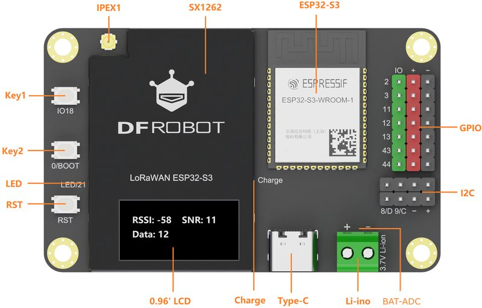

# DFRobot ESP32-S3 LoRaWAN Board (DFR1195)

[← Board-Übersicht](../README.md)

ESP32-S3 mit **LoRa-Funkchip SX1262 (868 MHz)**, **0,96"-Farbdisplay** (160×80), zwei Tastern, LED und Anschluss für einen Li-Ion-Akku. LoRa funkt kleine Datenmengen über mehrere Kilometer, z. B. Sensorwerte von draußen.

**Doku:** [DFRobot Wiki](https://wiki.dfrobot.com/SKU_DFR1195_LoRaWAN_ESP32_S3)
**PlatformIO:** Ordner als Startprojekt öffnen bzw. [platformio.ini](platformio.ini) kopieren. Die Datei stellt die generische ESP32-S3-Definition auf dieses Board um (Pinbelegung von DFRobot, 4 MB Flash, serielle Ausgabe über USB-C) und bindet die DFRobot-Bibliothek für Display und LoRa ein. Das Startprogramm zeigt „Fachschaft IT“ auf dem Display.

## Pinout

Quelle: DFRobot Wiki

## Freie Pins (Stiftleiste rechts)

| Pin | Funktion |
|---|---|
| IO2, IO3 | GPIO, analog |
| IO11 / IO12 / IO13 | GPIO, analog, SPI MISO / SCK / MOSI |
| IO43 / IO44 | UART0 TX / RX |
| IO8 = D | **I2C SDA** |
| IO9 = C | **I2C SCL** |
| + / − | 3,3 V Ausgang / GND |

## Fest belegte Pins

| Bauteil | GPIOs |
|---|---|
| LoRa SX1262 | MISO 5, MOSI 6, SCK 7, CS 10, BUSY 40, RST 41, RXEN 42, DIO1 4 |
| Display | MOSI 11, SCK 12, CS 17, RST 15, DC 14, Backlight 16, Power 48 |
| Taster Key1 / Key2 (BOOT) | GPIO18 / GPIO0 |
| LED | GPIO21 |
| Akkuspannung messen | GPIO1 (analog) |

→ Das Display nutzt GPIO11 und GPIO12. Wer das Display verwendet, sollte IO11/IO12 an der Stiftleiste nicht für etwas anderes nehmen.

## Worauf ihr achten müsst

- **Nie ohne LoRa-Antenne senden!** Antenne vorher auf den IPEX-Stecker drücken. Senden ohne Antenne kann den Funkchip beschädigen.
- **Akku** an die grüne Schraubklemme (3,7 V Li-Ion): **+ und − genau prüfen**, die Klemme schützt nicht vor Verpolung.
- **Akku laden:** Hängt USB-C dran, lädt das Board den Akku (max. 300 mA). Rote Lade-LED **an** = lädt, **aus** = voll (oder kein USB). Die Akkuspannung liegt über einen 1:2-Spannungsteiler an GPIO1: `analogReadMilliVolts(1) * 2` ergibt die Akkuspannung in mV. Ladestand-Tabelle: [Dos & Don'ts](../../DosAndDonts/README.md#laden-und-ladestand-prüfen).
- Display und LoRa laufen über die Bibliothek `DFRobot_LoRaWAN_ESP32S3` (ist in der `platformio.ini` schon eingetragen). Das Display heißt dort `LCD_OnBoard`, siehe [src/example.cpp](src/example.cpp). Beispiele für LoRa und LoRaWAN: [GitHub, Ordner examples](https://github.com/DFRobot/DFRobot_LoRaWAN_ESP32S3/tree/v1.0.1/examples).
