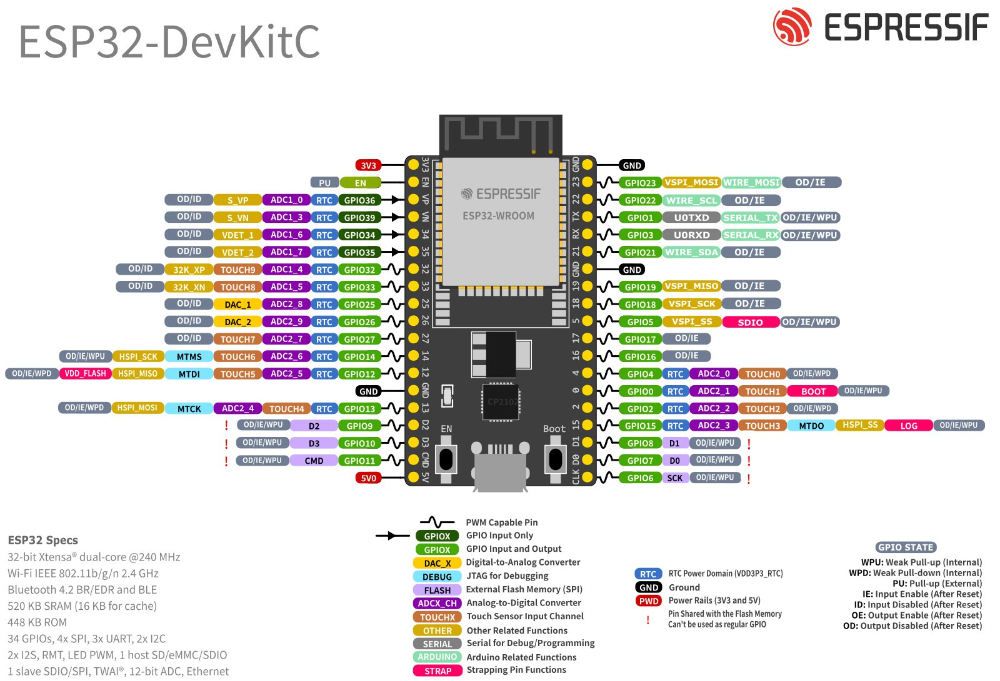

# ESP32 Entwicklungsboard WROOM-32 (38 Pins, CP2102)

[← Board-Übersicht](../README.md)

Der „klassische“ ESP32: 2 Kerne, 240 MHz, WLAN + Bluetooth, **Micro-USB**. Viele Pins und passt quer über ein Steckbrett. Die Pinbelegung entspricht dem ESP32-DevKitC von Espressif.

**Doku:** [Espressif ESP32-DevKitC Anleitung](https://docs.espressif.com/projects/esp-dev-kits/en/latest/esp32/esp32-devkitc/user_guide.html) · [ESP32-WROOM-32 Datenblatt](https://www.espressif.com/sites/default/files/documentation/esp32-wroom-32_datasheet_en.pdf) · [Produktseite Funduino](https://funduino.com/en/products/funduino-esp32-wroom32-wlan-wifi-development-board-with-cp2102)
**PlatformIO:** [platformio.ini](platformio.ini) in euer Projekt kopieren (Board `esp32dev`)
**USB-Treiber:** [Silicon Labs CP210x](https://www.silabs.com/developer-tools/usb-to-uart-bridge-vcp-drivers), falls kein COM-Port auftaucht

## Pinout

Quelle: Espressif. Im Zweifel gilt die Beschriftung auf eurem Board.

## Die wichtigsten Regeln für diesen Chip

| Pins | Was gilt |
|---|---|
| **GPIO21 / GPIO22** | Standard-**I2C**: SDA / SCL |
| **GPIO23 / 19 / 18 / 5** | Standard-**SPI**: MOSI / MISO / SCK / CS |
| **GPIO1 / GPIO3** | TX / RX der USB-Verbindung. **Nicht benutzen**, sonst klappt Upload/Serial nicht |
| **GPIO6–11** | Intern am Flash-Speicher. **Nie benutzen** |
| **GPIO34, 35, 36 (VP), 39 (VN)** | **Nur Eingang**, kein `OUTPUT`, kein interner Pull-up |
| **GPIO0, 2, 5, 12, 15** | Strapping-Pins: bestimmen beim Start den Boot-Modus. Möglichst meiden. Vor allem GPIO12 darf beim Start **nicht HIGH** sein |
| **ADC2** (GPIO0, 2, 4, 12–15, 25–27) | Analog-Lesen klappt **nicht**, solange WLAN an ist → für analoge Sensoren **ADC1** (GPIO32–39) nehmen |
| **GPIO25 / 26** | Echte Analog-Ausgänge (DAC) |

Sichere Allzweck-Pins: **GPIO4, 13, 14, 16, 17, 18, 19, 21, 22, 23, 25, 26, 27, 32, 33**.

Strom: **3V3** (Ausgang), **5V** (vom USB), **GND**. Eine eingebaute User-LED gibt es auf diesem Board nicht, für „Blink“ eine LED mit Vorwiderstand anschließen.

## Worauf ihr achten müsst

- Upload bleibt bei `Connecting....___` hängen? **BOOT-Taste gedrückt halten**, bis der Upload startet.
- Micro-USB-Kabel muss ein **Datenkabel** sein (reine Ladekabel gehen nicht).
