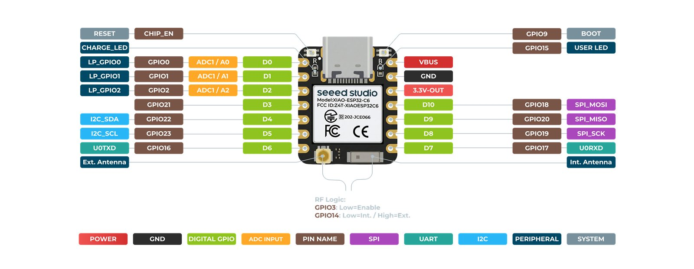

# Seeed XIAO ESP32-C6

[← Board-Übersicht](../README.md)

XIAO-Board mit ESP32-C6 (RISC-V, 160 MHz). Funkt neben **Wi-Fi 6** und **Bluetooth LE** auch **Zigbee** und **Thread/Matter**, also die Smart-Home-Funkstandards. Weniger Rechenleistung als der S3, dafür sparsamer.

**Doku:** [Seeed Wiki: Getting Started](https://wiki.seeedstudio.com/xiao_esp32c6_getting_started/) · [ESP32-C6 Datenblatt (Espressif)](https://www.espressif.com/sites/default/files/documentation/esp32-c6_datasheet_en.pdf)
**PlatformIO:** [platformio.ini](platformio.ini) in euer Projekt kopieren (Board `seeed_xiao_esp32c6`). Wichtig: Die Standard-Plattform `espressif32` aus dem PlatformIO-Assistenten kennt dieses Board nicht, darum unbedingt die Datei hier nehmen.

## Pinout

Quelle: Seeed Studio Wiki

## Pins auf einen Blick

| Pin | GPIO | Analog | Sonderfunktion |
|---|---|---|---|
| D0 | GPIO0 | A0 | |
| D1 | GPIO1 | A1 | |
| D2 | GPIO2 | A2 | |
| D3 | GPIO21 | – | |
| D4 | GPIO22 | – | **I2C SDA** |
| D5 | GPIO23 | – | **I2C SCL** |
| D6 | GPIO16 | – | UART TX |
| D7 | GPIO17 | – | UART RX |
| D8 | GPIO19 | – | SPI SCK |
| D9 | GPIO20 | – | SPI MISO |
| D10 | GPIO18 | – | SPI MOSI |
| User-LED | GPIO15 | | `LED_BUILTIN` |
| BOOT-Taster (B) | GPIO9 | | |

Strom: **5V**, **3V3** (Ausgang), **GND**. Rückseite: **BAT+ / BAT−** für einen 3,7-V-LiPo.

## Worauf ihr achten müsst

- **Nur 3 Analog-Pins** (D0–D2). Analoge Sensoren (z. B. Poti, Fotowiderstand, MQ-135) dort anschließen.
- **Antenne:** Standardmäßig nutzt das Board die eingebaute Keramikantenne. Für eine externe Antenne am U.FL-Stecker: GPIO3 auf LOW und GPIO14 auf HIGH setzen (Beispielcode im Wiki).
- **Akku nur an die BAT-Pads**, Polarität doppelt prüfen. Geladen wird automatisch, sobald USB-C dranhängt (Lade-LED an = lädt, aus = voll). Ladestand-Tabelle: [Dos & Don'ts](../../DosAndDonts/README.md#laden-und-ladestand-prüfen).
- Upload hängt? **BOOT gedrückt halten, USB einstecken, loslassen**, nochmal hochladen.
