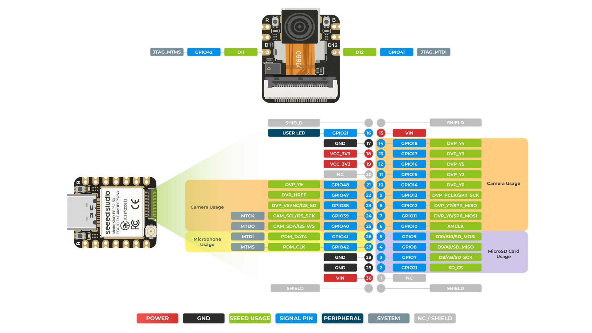

# Seeed XIAO ESP32-S3 Sense

[← Board-Übersicht](../README.md)

Ein [XIAO ESP32-S3](../XIAO-ESP32-S3/README.md) mit aufgestecktem Erweiterungsboard: **Kamera (OV3660)**, **digitales Mikrofon** und **microSD-Slot**. Ideal für Bild- und Spracherkennung direkt auf dem Board.

Alles aus der Doku zum [XIAO ESP32-S3](../XIAO-ESP32-S3/README.md) gilt auch hier, inklusive D0–D10-Belegung.

**Doku:** [Seeed Wiki: Getting Started](https://wiki.seeedstudio.com/xiao_esp32s3_getting_started/) · [Kamera-Nutzung](https://wiki.seeedstudio.com/xiao_esp32s3_camera_usage/) · [Mikrofon-Nutzung](https://wiki.seeedstudio.com/xiao_esp32s3_sense_mic/)
**PlatformIO:** [platformio.ini](platformio.ini) in euer Projekt kopieren (PSRAM für die Kamera ist schon eingestellt, 3,3 MB Platz fürs Programm)

## Pinout

Quelle: Seeed Studio Wiki

## Was die Erweiterung belegt

| Funktion | GPIO | Hinweis |
|---|---|---|
| Kamera | intern (B2B-Stecker) | belegt **keine** der D0–D10-Pins |
| Mikrofon PDM CLK | GPIO42 | |
| Mikrofon PDM DATA | GPIO41 | |
| microSD SCK / MISO / MOSI | GPIO7 / GPIO8 / GPIO9 | = **D8 / D9 / D10**, geteilt mit SPI |
| microSD CS | GPIO21 | geteilt mit der User-LED |

→ Wenn ihr die SD-Karte nutzt, sind **D8–D10** belegt (bzw. teilen sich den SPI-Bus mit anderen SPI-Modulen) und die User-LED flackert mit.

## Worauf ihr achten müsst

- **Kamera-Board nicht abziehen.** Der kleine B2B-Stecker verträgt nur wenige Steckzyklen.
- **Antenne anstecken**, gerade beim Streamen von Kamerabildern über WLAN.
- Kamera + WLAN ziehen bis ca. 350 mA. Das Board wird **warm**, das ist normal. Nicht in ein geschlossenes Gehäuse ohne Luft packen.
- microSD-Karten als **FAT32** formatieren (max. 32 GB empfohlen).
