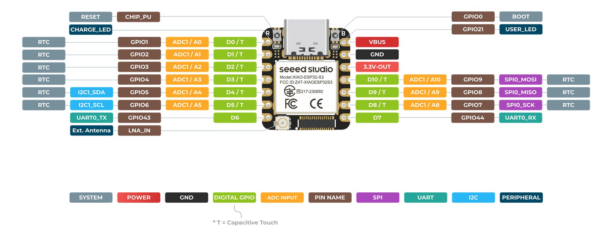
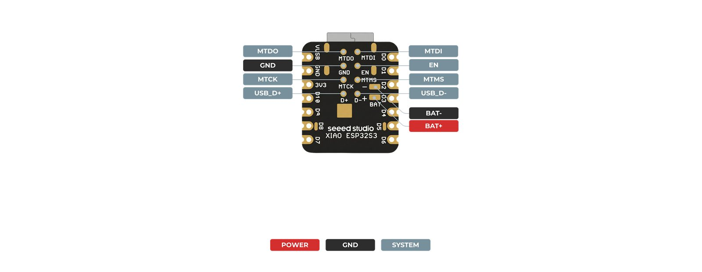

# Seeed XIAO ESP32-S3

[← Board-Übersicht](../README.md)

Daumennagelgroßes Board mit ESP32-S3 (2 Kerne, 240 MHz, 8 MB PSRAM, 8 MB Flash), WLAN und Bluetooth LE. USB-C, Lade-Schaltung für einen LiPo-Akku eingebaut.

**Doku:** [Seeed Wiki: Getting Started](https://wiki.seeedstudio.com/xiao_esp32s3_getting_started/) · [ESP32-S3 Datenblatt (Espressif)](https://www.espressif.com/sites/default/files/documentation/esp32-s3_datasheet_en.pdf)
**PlatformIO:** [platformio.ini](platformio.ini) in euer Projekt kopieren (Board `seeed_xiao_esp32s3`)

## Pinout

Quelle: Seeed Studio Wiki

## Pins auf einen Blick

| Pin | GPIO | Analog | Sonderfunktion |
|---|---|---|---|
| D0 | GPIO1 | A0 | |
| D1 | GPIO2 | A1 | |
| D2 | GPIO3 | A2 | |
| D3 | GPIO4 | A3 | |
| D4 | GPIO5 | A4 | **I2C SDA** |
| D5 | GPIO6 | A5 | **I2C SCL** |
| D6 | GPIO43 | – | UART TX |
| D7 | GPIO44 | – | UART RX |
| D8 | GPIO7 | A8 | SPI SCK |
| D9 | GPIO8 | A9 | SPI MISO |
| D10 | GPIO9 | A10 | SPI MOSI |
| User-LED | GPIO21 | | `LED_BUILTIN` |
| BOOT-Taster (B) | GPIO0 | | |

Strom: **5V** (= USB-Spannung), **3V3** (Ausgang für Sensoren), **GND**. Auf der Rückseite: **BAT+ / BAT−** für einen 3,7-V-LiPo.

## Worauf ihr achten müsst

- **Antenne anstecken!** Das Board hat keine eingebaute Antenne. Ohne die beiliegende Stabantenne am U.FL-Stecker ist das WLAN sehr schwach. Den Stecker gerade aufdrücken, nicht schräg ziehen.
- **Akku nur an die BAT-Pads** auf der Rückseite, nie an 3V3 oder 5V. Polarität doppelt prüfen. Geladen wird automatisch, sobald USB-C dranhängt (Lade-LED an = lädt, aus = voll). Ladestand-Tabelle: [Dos & Don'ts](../../DosAndDonts/README.md#laden-und-ladestand-prüfen).
- Mit WLAN oder bei Last wird der Chip spürbar warm. Heiß zum Anfassen ist er nicht normal → USB ab.
- Upload hängt bei „Connecting…“? **BOOT gedrückt halten, USB einstecken, loslassen**, dann nochmal hochladen.
- `Serial.println` zeigt nichts? Nach dem Upload einmal **RESET** (Taste R) drücken und den seriellen Monitor neu öffnen.
