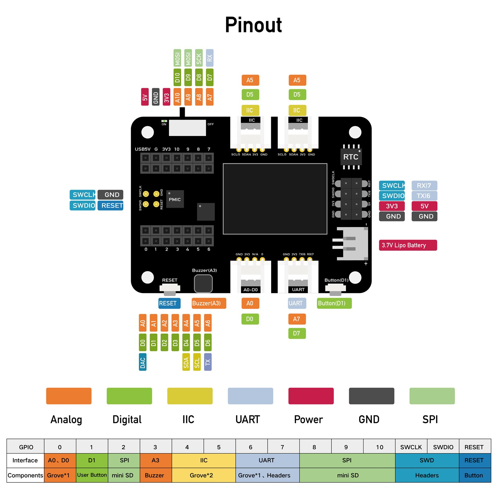

# Seeed XIAO Expansion Board

[← Board-Übersicht](../README.md)

Aufsteckboard für jedes XIAO-Board (S3, S3 Sense, C6). Bringt fertig verdrahtet mit: **OLED-Display**, **Echtzeituhr (RTC)**, **Buzzer**, **Taster**, **microSD-Slot**, **4 Grove-Buchsen**, Akku-Anschluss mit Schalter. Gut, um ohne Steckbrett schnell etwas anzuzeigen.

**Doku:** [Seeed Wiki: XIAO Expansion Board](https://wiki.seeedstudio.com/Seeeduino-XIAO-Expansion-Board/)
**PlatformIO:** [platformio.ini](platformio.ini) in euer Projekt kopieren. Sie ist für einen XIAO ESP32-S3 eingestellt und bringt die Bibliotheken für OLED (U8g2) und Uhr (PCF8563) gleich mit.

## Pinout

Quelle: Seeed Studio Wiki

## Was auf dem Board fest verdrahtet ist

| Bauteil | XIAO-Pin | Hinweis |
|---|---|---|
| OLED 0,96" 128×64 (SSD1306) | D4 / D5 (I2C) | I2C-Adresse `0x3C`, z. B. mit der Bibliothek U8g2 |
| Echtzeituhr PCF8563 | D4 / D5 (I2C) | I2C-Adresse `0x51`, Knopfzelle CR1220 für Gangreserve |
| Buzzer (passiv) | **D3 / A3** | mit `tone(D3, 1000)` ansteuern |
| User-Taster | **D1** | |
| microSD | **D2** (CS) + D8–D10 (SPI) | |
| Grove I2C (2×) | D4 / D5 | für Grove-Sensoren |
| Grove UART | D6 / D7 | |
| Grove A0/D0 | D0 | analog oder digital |
| LiPo-Anschluss + Schalter | BAT | 3,7 V LiPo |

→ Steckt ein XIAO auf dem Board, sind **D1, D2 und D3** schon belegt. Für eigene Bauteile bleiben D0 und die Pins an der Stiftleiste.

## Worauf ihr achten müsst

- **Richtung beim Aufstecken:** Der USB-C-Stecker des XIAO zeigt zur Kante des Boards (siehe Umriss auf der Platine). Falsch herum gesteckt = Kurzschluss.
- Das XIAO braucht dafür **eingelötete Stiftleisten**. Fragt bei uns nach, falls euer XIAO keine hat.
- Akku über den JST-Stecker anschließen, Polarität prüfen (siehe [Dos & Don'ts](../../DosAndDonts/README.md)).
